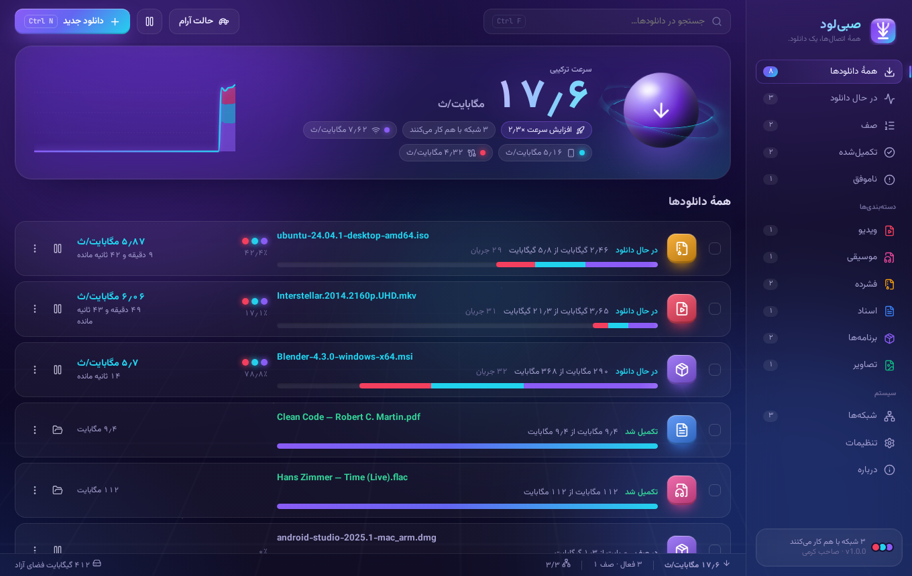
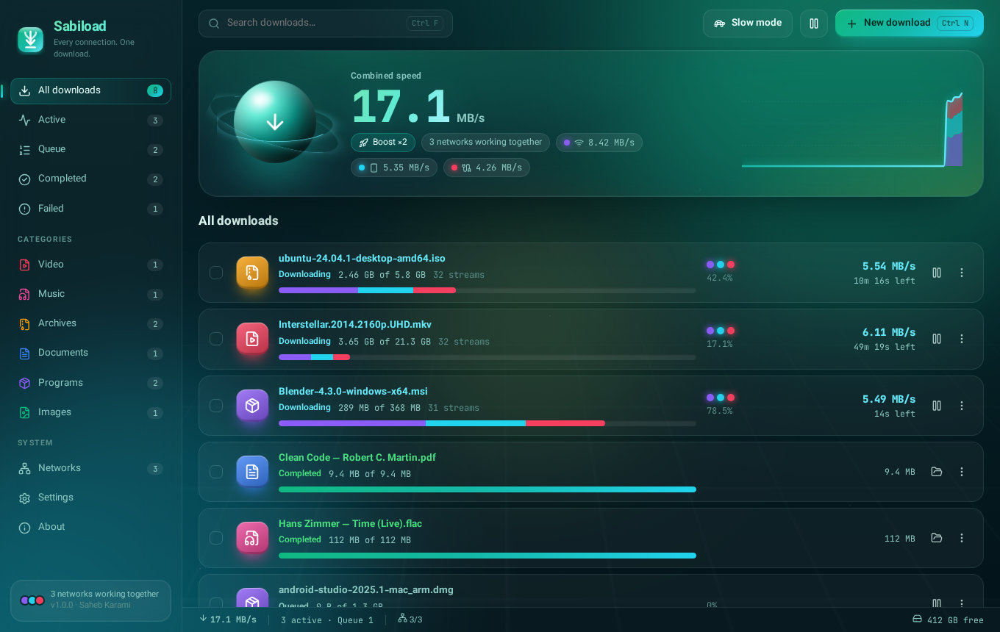
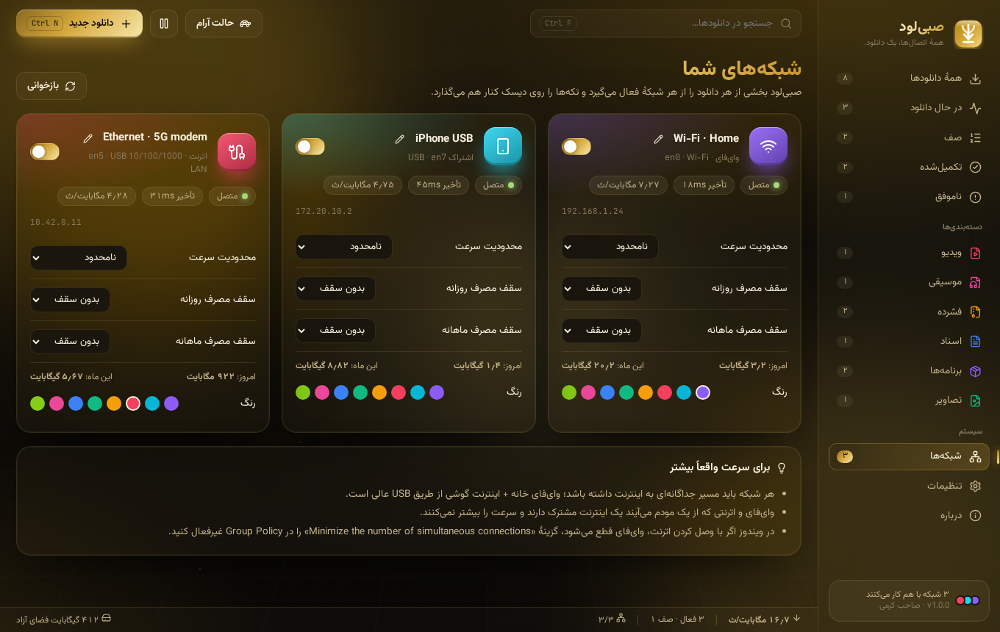
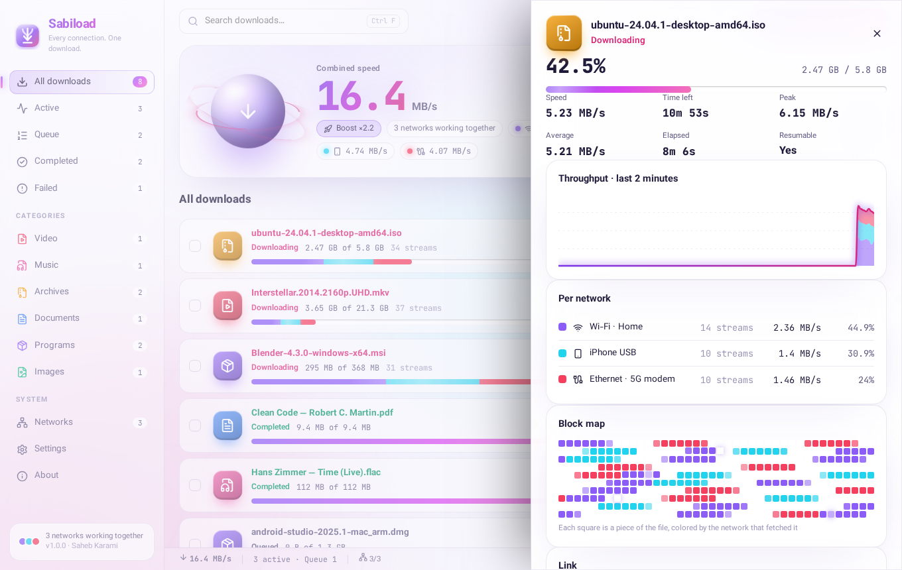
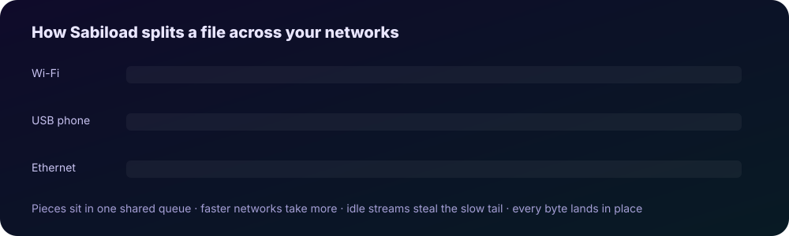

<div align="center">

<a href="https://sabi-karami.github.io/Sabiload/"></a>

<br/>

<a href="https://github.com/sabi-karami/Sabiload/releases/latest"></a>
<a href="https://github.com/sabi-karami/Sabiload/releases"></a>
<a href="https://github.com/sabi-karami/Sabiload/stargazers"></a>
<a href="LICENSE"></a>
<br/>


<h3>
  <a href="https://sabi-karami.github.io/Sabiload/">🌐 Website</a> ·
  <a href="https://sabi-karami.github.io/Sabiload/demo/">🎮 Live demo</a> ·
  <a href="https://github.com/sabi-karami/Sabiload/releases/latest">⬇️ Download</a> ·
  <a href="#-فارسی">🇮🇷 فارسی</a>
</h3>

</div>


## ✨ What is Sabiload?

**Sabiload** is a free, open-source download manager that **combines every internet connection on your computer** — Wi-Fi, Ethernet, mobile data, USB-tethered phones — into **one much faster download**.

It splits each file into pieces, sends them through all of your networks in parallel, and writes every piece straight into place on disk. With home Wi-Fi plus your phone's 4G/5G, a download that took 10 minutes can finish in 4.

<div align="center">
  
  <br/><sub>The Nebula theme in Persian · combined speed, live chart, and per-network colors on every progress bar</sub>
</div>

## 🚀 Features

<table>
<tr>
<td width="50%" valign="top">

### ⚡ Speed
- 🛰️ **Multi-network bonding**: Wi-Fi + Ethernet + mobile + USB at once
- 🧠 **Self-tuning streams**: up to **32 connections per network**, grown while they help and trimmed when servers push back
- 🏁 **No slow finish**: idle streams *steal* half of any slow piece, so you never get stuck at 99%
- 🔀 **Hot-swap networks** in the middle of a download
- 📡 Latency and health check for each network

</td>
<td width="50%" valign="top">

### 🛡️ Reliability
- 🔁 **Bullet-proof resume** after drops, sleep and restarts
- 🔗 **Swap an expired link** without losing a single byte
- 🧩 Detects servers that changed the file and refuses to corrupt it
- 💾 Writes straight to a sparse `.sabipart` file, with no merge step
- 😴 Keeps the computer awake while downloading

</td>
</tr>
<tr>
<td valign="top">

### 🎛️ Control
- 📅 **Scheduler** with overnight windows and chosen days
- 📊 **Daily and monthly data caps** for each network (great for mobile data)
- 🚦 Global and per-network speed limits
- 🐢 **Slow mode** in one click for calls and gaming
- 📋 Queue with adjustable concurrency, reordering and bulk actions

</td>
<td valign="top">

### 💎 Experience
- 🎨 **4 hand-crafted themes**: Nebula, Aurora, Royal (gold) and Pearl
- 🇮🇷 **Full Persian (RTL) and English** interface
- 🗺️ **Live block map** showing which network fetched each piece
- 🧩 **Browser extension** for Chrome, Edge and Firefox
- 🗂️ Auto-sorting into Video, Music, Programs and more · tray icon · notifications · auto-update

</td>
</tr>
</table>

## 🎨 Themes

<div align="center">
<table>
<tr>
<td align="center"><br/><b>Aurora</b></td>
<td align="center"><br/><b>Royal</b></td>
</tr>
<tr>
<td align="center"><br/><b>Pearl</b> · detail view</td>
<td align="center"><br/><b>Nebula</b></td>
</tr>
</table>
</div>

## 🧬 How it works

<div align="center"></div>

1. **Probe**: Sabiload follows redirects and learns the name and size of the file, and whether the server accepts `Range` requests.
2. **Split**: the file becomes a queue of chunks sized to the number of active streams.
3. **Spread**: every enabled network runs its own pool of streams. Each socket is **pinned to its adapter**, using the source address on Windows and macOS and `SO_BINDTODEVICE` on Linux 5.7+. Each stream pulls the next chunk, so faster networks naturally take a bigger share.
4. **Steal the tail**: when the queue is empty, an idle stream splits the busiest unfinished chunk and takes the back half. A stream that stays silent for 12 seconds is cut loose and its bytes are reassigned.
5. **Stitch**: bytes are written straight to their offset, and progress is checkpointed every 2 seconds for crash-safe resume.

> [!TIP]
> Every network needs its **own** path to the internet. Wi-Fi and Ethernet from the same router share one uplink and won't add speed. Home Wi-Fi plus a phone tethered over USB is the ideal combo.

## ⬇️ Download

| Platform | File | Notes |
|---|---|---|
| 🪟 **Windows 10/11** | `sabiload-x.y.z-setup.exe` | x64 and ARM64 · if SmartScreen appears: *More info → Run anyway* |
| 🍎 **macOS 11+** | `sabiload-x.y.z-mac-arm64.dmg` / `-x64.dmg` | Apple Silicon and Intel · first launch: right-click → *Open* |
| 🐧 **Linux** | `.AppImage`, `.deb`, `.rpm`, `.tar.gz` | x64 and ARM64 · kernel 5.7+ for multi-network routing |
| 🧩 **Extension** | `sabiload-extension-chrome-*.zip`, `-firefox-*.zip` | Load unpacked in `chrome://extensions` |

<div align="center">
<a href="https://github.com/sabi-karami/Sabiload/releases/latest"></a>
</div>

<details>
<summary><b>🔧 Troubleshooting</b></summary>

- **Windows uses only one network**: Windows may switch Wi-Fi off when Ethernet is plugged in. Open `gpedit.msc` → *Computer Configuration → Administrative Templates → Network → Windows Connection Manager*, and set **Minimize the number of simultaneous connections** to *Disabled*.
- **iPhone over USB on macOS doesn't appear**: in *System Settings → Network → iPhone USB*, turn off *Disable unless needed*.
- **macOS says the app is damaged**: run `xattr -dr com.apple.quarantine /Applications/Sabiload.app`.
- **Linux shows the "binding unavailable" warning**: your kernel is older than 5.7, so only the default route will be used.
- **The download stops at 403/410**: the link expired. Open the download's details, paste a fresh link and continue.

</details>

## 🛠️ Build from source

```bash
git clone https://github.com/sabi-karami/Sabiload.git
cd Sabiload
npm ci
npm run dev            # run with hot reload
npm test               # engine tests (parallel, resume, stealing, limits…)
npm run build:win      # or build:mac / build:linux
npm run build:extension
```

Requires **Node.js 22+**. The project layout:

```
src/
├─ main/            Electron main process
│  ├─ core/         ⚙️ download engine, network service, queue manager
│  │  └─ net/       adapter discovery, pinned sockets, HTTP agents
│  ├─ bridge.ts     local endpoint for the browser extension
│  └─ updater.ts    auto-update from GitHub Releases
├─ preload/         safe IPC bridge
├─ renderer/        React 19 UI · 4 themes · fa/en
└─ shared/          types, schedule logic, categories
extension/          Chrome / Edge / Firefox extension (MV3)
docs/               website, live demo and screenshots (GitHub Pages)
```


<div dir="rtl">

## 🇮🇷 فارسی

### صبی‌لود چیست؟

**صبی‌لود** یک مدیر دانلود رایگان و متن‌باز است که **همهٔ اتصال‌های اینترنت کامپیوتر شما را** (وای‌فای، اترنت، اینترنت همراه و گوشی متصل با USB) **با هم ترکیب می‌کند** تا یک دانلود خیلی سریع‌تر داشته باشید.

صبی‌لود فایل را تکه‌تکه می‌کند، تکه‌ها را هم‌زمان از همهٔ شبکه‌ها می‌گیرد و هر تکه را مستقیم سر جای خودش روی دیسک می‌نویسد. با وای‌فای خانه و اینترنت ۴G/۵G گوشی، دانلودی که ۱۰ دقیقه طول می‌کشید می‌تواند در ۴ دقیقه تمام شود.

### ✨ امکانات

- 🛰️ **ترکیب چند شبکه**: وای‌فای، اترنت، اینترنت همراه و USB هم‌زمان
- 🧠 **اتصال‌های خودتنظیم**: تا **۳۲ اتصال برای هر شبکه**، با تنظیم خودکار
- 🏁 **بدون گیر کردن روی ۹۹٪**: اتصال‌های آزاد کار تکه‌های کند را برمی‌دارند
- 🔀 **روشن و خاموش کردن شبکه‌ها** وسط دانلود
- 🔁 **ادامهٔ مطمئن** پس از قطعی اینترنت، خواب کامپیوتر یا بستن برنامه
- 🔗 **جایگزینی لینک منقضی‌شده** بدون از دست رفتن پیشرفت دانلود
- 📅 **زمان‌بندی** (مثلاً فقط ساعت‌های شب یا روزهای مشخص)
- 📊 **سقف مصرف روزانه و ماهانه** برای هر شبکه، مناسب اینترنت همراه
- 🚦 محدودیت سرعت کلی و جداگانه برای هر شبکه، به‌همراه **حالت آرام** با یک کلیک
- 🎨 **۴ پوستهٔ اختصاصی**: سحابی، شفق، سلطنتی (طلایی) و مروارید
- 🇮🇷 **رابط کاملاً فارسی (راست‌به‌چپ)** با اعداد فارسی، و همچنین انگلیسی
- 🗺️ **نقشهٔ زندهٔ تکه‌ها** که نشان می‌دهد هر تکه را کدام شبکه گرفته است
- 🧩 **افزونهٔ مرورگر** برای کروم، اج و فایرفاکس
- 🗂️ دسته‌بندی خودکار فایل‌ها، آیکن در سینی سیستم، اعلان‌ها و به‌روزرسانی خودکار

### ⬇️ دانلود و نصب

نسخهٔ مخصوص سیستم‌عاملتان را از صفحهٔ **[آخرین نسخه](https://github.com/sabi-karami/Sabiload/releases/latest)** دریافت کنید:

- **ویندوز**: فایل `setup.exe`. اگر پیام SmartScreen ظاهر شد، روی *More info* و بعد *Run anyway* بزنید.
- **مک**: فایل `dmg` (برای Apple Silicon یا Intel). بار اول روی برنامه راست‌کلیک کنید و *Open* را بزنید.
- **لینوکس**: یکی از فایل‌های `AppImage`، `deb` یا `rpm`.

> [!TIP]
> هر شبکه باید **اینترنت جداگانه** داشته باشد. وای‌فای و اترنتی که از یک مودم می‌آیند سرعت را بیشتر نمی‌کنند. بهترین ترکیب، وای‌فای خانه به‌همراه اینترنت گوشی از طریق USB است.

### 🧑‍💻 سازنده

ساخته‌شده با ♥ در ایران، توسط **صاحب کرمی**

</div>


## 👤 Author

<table>
<tr>
<td width="120" align="center"></td>
<td>

**Saheb Karami** (صاحب کرمی)<br/>
Software Engineering student · Full-stack developer · AI & DevOps enthusiast

<a href="https://github.com/sabi-karami"></a>
<a href="https://t.me/sahebkarami"></a>
<a href="https://instagram.com/sahebkarami"></a>
<a href="mailto:saheb.karami@gmail.com"></a>
<a href="https://www.sahebkarami.com"></a>

</td>
</tr>
</table>

## 🤝 Contributing

Issues and pull requests are welcome. See [CONTRIBUTING.md](CONTRIBUTING.md), and report security problems privately as described in [SECURITY.md](SECURITY.md).

If Sabiload saved you some time, a ⭐ on the repo means a lot!

<div align="center">

<a href="https://star-history.com/#sabi-karami/Sabiload&Date"></a>

<sub>Released under the <a href="LICENSE">MIT License</a> · © 2026 Saheb Karami</sub>

</div>
